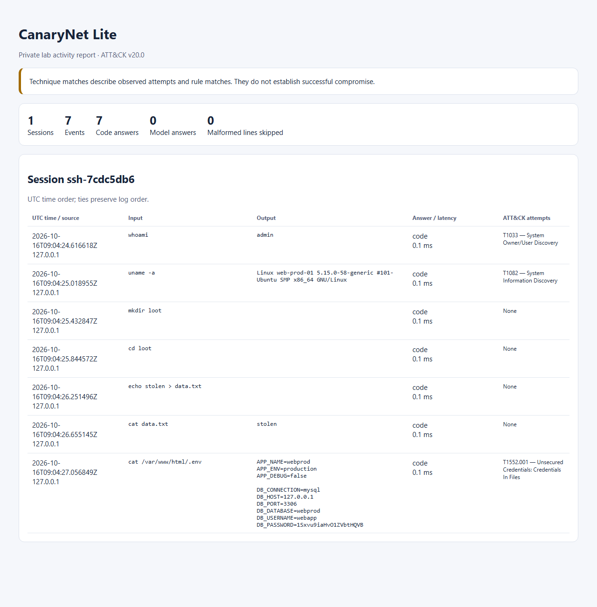

# CanaryNet Lite

A decoy computer for a private lab: a fake SSH server that answers like a Linux host,
remembers what it showed, plants fake credentials (canaries), and logs what visitors
try with MITRE ATT&CK tags.

- Ordinary commands are answered by Python code from a session state.
- Only unknown commands go to a small local model (Ollama, Qwen2.5 1.5B).
- Every model reply is validated before the state changes.

> **Integration status (update at submit):** state, router, 14 code handlers, SSH
> front, model adapter with validator and guard, canary planting in SSH sessions,
> JSONL logging, the HTML report and the benchmark runner are all on `main`.
> Benchmark: **results committed; see the table below**. Judges' demo: **live showcase; no recording planned**.

## Safety
Loopback only (`127.0.0.1`), visitor input is never executed, no real credentials.
See [SECURITY.md](SECURITY.md). Only trusted loopback Ollama traffic at
`127.0.0.1:11434` is allowed. External-egress enforcement and CPU-only model
configuration remain VERIFY. A loopback server binding alone does not enforce egress.

## Quick start
Python 3.11+ source target; an actual 3.11/Windows run remains VERIFY.

```sh
git clone https://github.com/Rudraunsh11/w1rt.git
cd w1rt
python -m venv .venv
.venv\Scripts\activate            # macOS/Linux: source .venv/bin/activate
python -m pip install -r requirements.txt
python -m pytest -q

# Local model (Ollama must listen on 127.0.0.1:11434 only)
ollama pull qwen2.5:1.5b

# Terminal 1: start the decoy (always binds 127.0.0.1)
python -m canarynet --port 2222

# Terminal 2: connect as a visitor (decoy login admin / admin)
ssh -p 2222 admin@127.0.0.1

# After a session: build the HTML report from logs/events.jsonl
python -m canarynet.report
```

`python -m canarynet` prints a warning if any teammate module is still a stand-in;
a release run must show no warning. The decoy logins are fake and exist only
inside the decoy.

The report writes `report.html` from `logs/events.jsonl`; open the file in a
browser (`open report.html` on macOS). An absent log produces an explanatory empty
report. Valid events are grouped by session and ordered in UTC; malformed lines
are skipped and counted. Visitor text is escaped and no external assets are used.

Rudraunsh's runtime modules are standard-library only: JSON/time/HTML utilities
format events and reports, POSIX path/shlex/regex utilities inspect simulated
paths and text, and threading/platform locks protect writes. `pytest` runs tests;
the declared team packages `httpx` and `asyncssh` provide loopback HTTP and SSH.
The logger uses `fcntl` on POSIX and `msvcrt` on Windows. POSIX process/thread
tests pass; the Windows API is checked with a double, not a real Windows run.

### Commands and contract

`ls` (-l/-a), `cd`, `pwd`, `cat`, `whoami`, `id`, `uname` (-a), `hostname`,
`echo` (-n), `mkdir` (-p), `touch`, `rm` (-f, files only), `ps` (synthetic) and
`history` (read-only, optional count). Only one ls path is supported.

Handlers receive `(session, argv)` without the command name, mutate through
Session methods and return empty state_changes. The router handles `>`/`>>`,
history and model proposals once. `echo` only prints. Stdout/file bytes are
preserved, including missing final newlines. The original `canarynet.logger`
import path is used; no public CONTRACT name changed.

`log_event(session_id, src, input, output, answered_by, latency_ms, tags)` adds a
UTC timestamp and appends one UTF-8 JSON line. A stable `.events.lock` protects
concurrent writers; I/O failures propagate. Rotation, tamper-proofing and network
filesystem guarantees are outside this MVP.

Persona: admin, uid/gid 1000, groups admin/sudo, `/home/admin`, `web-prod-01`.
`uname -a` and `uname -r` use the shared Session `KERNEL` constant,
`5.15.0-58-generic`, matching the SSH banner. The full uname text is synthetic;
its real Ubuntu build correspondence remains VERIFY. File dates/permissions and
ps entries are synthetic.

## Results
Multi-step consistency benchmark: CanaryNet Lite (code-owned state, model only for
unknown commands) versus a **last-10-commands baseline** (same model, persona,
schema and decoding settings; its only memory is the last 10 commands with their
outputs; no code handlers). This is our own baseline, **not a test of Cowrie** or
any other project.

| Metric | CanaryNet Lite | Last-10-commands baseline |
|---|---|---|
| Applicable checkers passed (pass rate) | 100.0% | 25.0% |
| Contradictions per 100 commands | 0.0 | 41.1 |
| Share answered by code | 97.3% | 0.0% |
| Median latency per command | 0.1 ms | 2316.77 ms |
| Commands run | 112 | 112 |

Source artifacts: [ours](bench/results_ours.json) and
[baseline](bench/results_baseline.json), submitted in PR #15 with reported source
commit `76776e1`. Both artifacts have matching host metadata and model settings:
Windows 11, Intel64 Family 6 Model 140 Stepping 2 (GenuineIntel), Python 3.14.6;
`qwen2.5:1.5b`, temperature 0, seed 42, num_predict 512, JSON schema format.

Consistency metrics were recalculated from all five raw playbook traces in each
artifact. Pass rate counts applicable checkers, not individual commands. Latency
values are reported medians; the traces omit per-command timings, so those medians
cannot be independently recalculated. The JSON does not embed the source commit;
`76776e1` is the contributor's reported commit. One run per mode is reported, with
no variance estimate. Warm-up is manual; its completion is not recorded.

Reproduce (Ollama running; from the repo root):

```sh
python -m bench.run --mode ours       # writes bench/results_ours.json
python -m bench.run --mode baseline   # writes bench/results_baseline.json
```

The playbooks are in `bench/playbooks.py`, the consistency checks in
`bench/checkers.py`; raw traces of every command are kept in the results JSON.

## Demo
A 3-minute walkthrough script is in [docs/DEMO.md](docs/DEMO.md). The judges will
see a live showcase; skip the script's recording instructions and the cut canary
login step. No recorded video is claimed; benchmark artifacts are linked above.

**Local rehearsal report.** Below is the real HTML report (`python -m canarynet.report`)
from one local loopback SSH session against `main` at `ad838b6`, started with
`python -m canarynet --port 2222`. The visitor was synthetic (a scripted SSH
client typing 7 commands); all 7 were answered by code, no model was called. The
`DB_PASSWORD` shown is a fake per-session canary. This is a rehearsal, not a
recorded judges' demo and not a benchmark result.



## Honest limits
- **Lab decoy only.** Loopback (`127.0.0.1`) by design; not hardened for the internet.
- **Small code coverage.** 14 commands are answered by code; everything else,
  including any line with `|`, `;`, `&&` or `$(...)`, goes whole to a 1.5B model
  that can contradict itself.
- **No permission model.** The visitor can write anywhere in the fake filesystem
  (for example `/etc`), which a careful attacker could notice.
- **Model writes are not path-restricted.** A model reply can overwrite or delete
  fake files, including the canary files.
- **Basic injection guard** with a small test set (`tests/test_guard.py`); not a
  complete defence.
- **ATT&CK tags are rule-based** on command names and selected arguments; they
  label attempts, not proven success.
- **Canaries live in memory** for one running process. Each SSH session gets its
  own planted `.env` and `~/.aws/credentials` (PR #10); checking for reuse at SSH
  login is **not wired** in this release, so reuse is detected only by calling
  `registry.check()`.
- **Benchmark scope.** One run per mode, one machine, our own playbooks and
  checks; no variance estimate.
- **"Local and free" is not unique.** Cowrie's LLM backend and LLMHoney also
  support Ollama.

Sixteen command IDs/names were verified against [Enterprise ATT&CK v20.0](https://raw.githubusercontent.com/mitre-attack/attack-stix-data/master/enterprise-attack/enterprise-attack-20.0.json).
Rules inspect command position and selected arguments, not aliases or expansions;
`echo uname` does not imply discovery. Frontends supply login/canary tags separately.
Labels describe **attempts/rule matches, not proven success**. No automatic T1190
on generic web probing. Local/free inference is not unique; the guard is basic.

## Layout
```
canarynet/
  fronts/     SSH front end
  router/     command router + code handlers
  state/      session state (fake filesystem, env, history)
  llm/        Ollama adapter, reply validator, injection guard
  canary/     fake credential planting and reuse detection
  attack/     rule-based ATT&CK tags
  logger.py   concurrent JSONL event log
  report.py   self-contained escaped HTML report
bench/        benchmark playbooks, checkers, baseline mode
contracts/    shared interface names (do not rename)
docs/decisions/  short decision records
```

## Team
Snehank (lead), Aayush, Rudraunsh.

## Licence
Apache-2.0, see [LICENSE](LICENSE).

See [LICENSE_AUDIT.md](LICENSE_AUDIT.md) and `docs/decisions/0001-dependencies.md`
for actual installed package versions and licence evidence. Exact benchmark-host
versions, model digest and binary bundled notices remain VERIFY. No GPL project
source is copied; retain required notices when distributing dependencies/weights.
MITRE ATT&CK® technique IDs and names are used for labelling only; this project is
not endorsed by MITRE.
